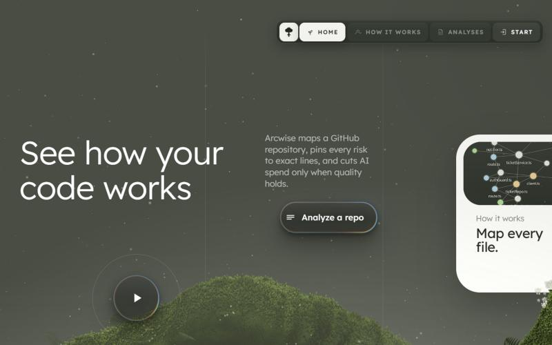
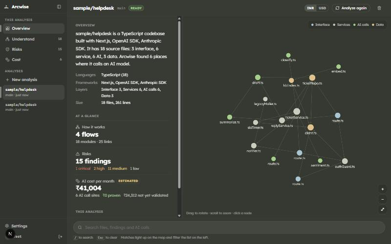
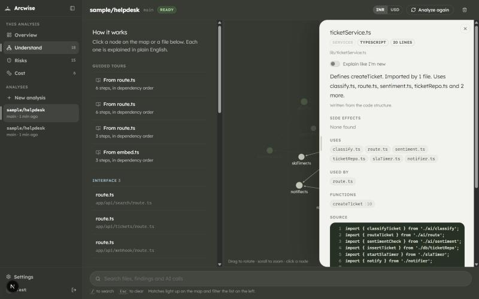
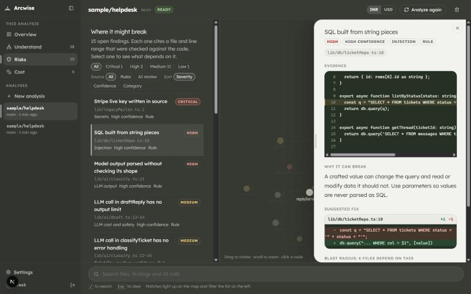
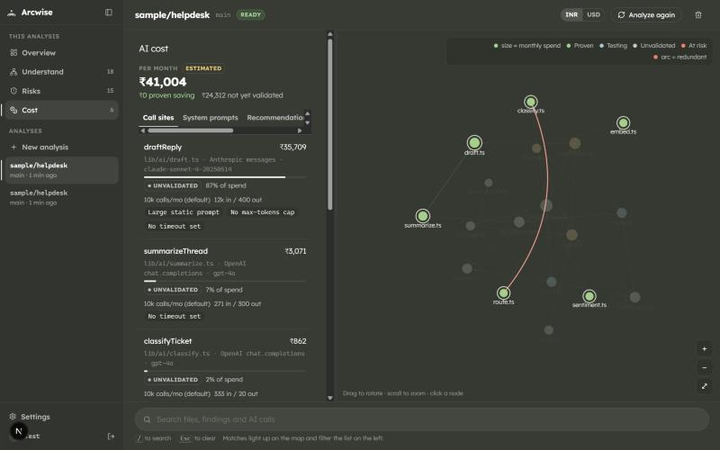

# Arcwise

**See how your code works, where it breaks, and what its AI costs.**

Arcwise reads a GitHub repository and turns it into a map you can review: a plain-English explanation for every file, risks pinned to exact lines, and every AI/LLM call priced, with cheaper options that only count as savings once a quality check proves nothing got worse.



---

## What you get for a repository

| | |
|---|---|
|  | **Overview.** What the app does, its languages and frameworks, its layers, and three headline numbers: flows, risks by severity, and estimated monthly AI spend. |
|  | **Understand.** Every file is a node in a graph, connected to what it imports. Click one for a summary, what it uses, what uses it, its side effects (database, network, AI) and the source. Guided tours follow the code in dependency order. |
|  | **Risks.** Findings such as hard-coded secrets (masked), SQL built from strings, unvalidated model output, missing output limits, swallowed errors, floating promises and untested central files. Each cites a file and line range that was checked against the code, includes a suggested fix, and shows its blast radius (everything that depends on it). |
|  | **Cost (TokenWise).** Every call to OpenAI, Anthropic, Google, OpenRouter, Groq, Together, DeepSeek, Mistral, xAI, the Vercel AI SDK, LangChain and LiteLLM, with its model and system prompt resolved and its monthly cost estimated from a dated price list. Redundant calls are shown as red arcs. |

### The quality gate

A cheaper model or a shorter prompt is only a **Proven** saving after Arcwise replays the current and the cheaper version on the same inputs, using your own API key, and the lower end of the 95% confidence interval of the quality difference stays above your limit. Otherwise the result is **At risk**, with the failing examples shown. Proven savings go to a savings ledger with a shareable report.

---

## Features

- **Accounts:** email and password sign-up (scrypt-hashed, rate-limited), optional GitHub OAuth. Every analysis is private to its owner.
- **Analysis pipeline:** clone → parse → map → explain → risks → AI cost, with live progress. The map opens as soon as the structure is ready.
- **Reads, never runs:** repositories are shallow-cloned into a temporary folder, parsed, and deleted.
- **Graph view:** an Obsidian-style force layout with zoom, fit, hover focus and search.
- **Resizable workspace:** a draggable reading pane and details panel, with an anchored search dock (`/` to focus).
- **Prompt optimiser:** shortens system prompts and checks that every instruction survives.
- **Usage import:** OpenAI and Anthropic usage CSV, Langfuse, Helicone and OpenTelemetry GenAI JSON replace estimated volumes with real ones.
- **INR / USD**, with a dated exchange rate.
- **Delete analyses** at any time (permanent).
- **Optional Claude:** with a Claude key, Claude writes the file summaries, overview and flows, reviews risky code, rewrites prompts and judges free-text replays. Without one, everything is derived from the code structure and deterministic rules.

---

## Run it locally

Requires **Node 22+** and **git**.

```bash
npm install
npm run dev
```

Open <http://localhost:3000>, create an account, and paste a public GitHub URL or open one of the sample projects.

### Configuration (`.env`, all optional)

Copy `.env.example` to `.env`.

| Variable | Purpose |
|---|---|
| `ANTHROPIC_API_KEY`, `ARCWISE_MODEL_DEEP`, `ARCWISE_MODEL_BULK` | Claude-written explanations, AI risk review, prompt rewrites, synthetic test inputs and the replay judge |
| `ARCWISE_ENCRYPTION_KEY` | 64 hex characters. Lets users save provider keys (encrypted at rest) for replays |
| `ARCWISE_SESSION_SECRET` | Signs session cookies. **Required in production** (32+ characters) |
| `GITHUB_CLIENT_ID`, `GITHUB_CLIENT_SECRET`, `ARCWISE_BASE_URL` | Optional "Continue with GitHub" sign-in |
| `ARCWISE_GUEST=1` | Re-enables guest access for demos (off by default) |
| `ARCWISE_MAX_FILES`, `ARCWISE_MAX_REPO_MB` | Repository size limits (defaults: 20,000 files, 500 MB) |

### Commands

| Command | What it does |
|---|---|
| `npm run dev` | Express + Next.js dev server on port 3000 |
| `npm test` | Unit tests and fixture tests (Vitest) |
| `npm run typecheck` | `tsc --noEmit` |
| `npm run pricing:check` | Lists price entries older than 30 days |
| `npm run build && npm start` | Production build |
| `docker compose up` | Run in a container (data in a volume) |

---

## How it works

```
Browser ──► Express (server/index.ts)
              ├─ /auth/*   accounts and sessions (server/auth.ts)
              ├─ /api/*    analyses, findings, costs, replays (server/routes.ts)
              └─ everything else ──► Next.js pages (app/, components/)

POST /api/analyses ──► job queue ──► pipeline (server/engine/pipeline.ts)
   clone (source.ts) → parse (parse.ts) → map → ┬ explain (explain.ts)
                                                ├ risks (risk/rules.ts, risk/osv.ts, risk/review.ts)
                                                └ AI cost (tokenwise/detect.ts, analyzers.ts, pricing.json)
   progress is streamed to the browser over server-sent events
```

- **Parsing** finds functions, imports and side effects for TypeScript, JavaScript and Python, and builds the file graph.
- **Risk findings** are dropped automatically if their cited lines do not exist or do not contain the quoted code.
- **AI cost** resolves the model (literals, constants, env defaults) and the system prompt (inline, constants imported from other files, prompt files on disk), estimates tokens, and prices each call.
- **Quality gate** (`server/engine/gate/`): replay → scoring (classification agreement, structured-output match, extraction F1, position-swapped judge, assertions) → bootstrap 95% interval → ledger.
- **Storage:** JSON documents in `.data/` (analyses, users, encrypted keys). This is behind `server/store.ts`, so it can be swapped for Postgres and object storage.

### Project layout

```
app/                 Next.js pages: /start, /signin, /a/[id] workspace, /r/[id] report
components/          UI: workspace, graph, dock navigation, dialogs
server/              Express server, auth, routes, store, job queue
server/engine/       analysis engine (parse, explain, risk, tokenwise, gate)
lib/                 shared types and helpers
public/landing-pages homepage (Three.js scene) and its assets
fixtures/            three sample apps, each with an expected.json the tests check
tests/               Vitest suites
scripts/             helper scripts (homepage card images)
```

---

## Tests

```bash
npm test
```

There are 50 tests. They cover the price maths, the bootstrap statistics, scoring, the replay gate (with a fake model), secret detection and redaction, finding verification, parsing, the prompt optimiser, usage import, key encryption, and three fixture repositories (a TypeScript help desk, a FastAPI app and a Next.js AI SDK app) compared against their `expected.json`.

## Status and roadmap

See [`PROGRESS.md`](PROGRESS.md). Next up: Postgres and BullMQ behind the existing store and queue interfaces, tree-sitter parsing, private repositories through a GitHub App, and a Playwright smoke test.

## Credits

- Builds on ideas and agent prompts from [Understand-Anything](https://github.com/Egonex-AI/Understand-Anything) (MIT). See `NOTICE`.
- The homepage scene and visual theme come from ThreeUI's *Sylva* landing page (`src/shaders/landing-pages/`, `public/landing-pages/`).
- 3D rendering by [Three.js](https://threejs.org) (MIT). Lexend typeface (SIL OFL).
